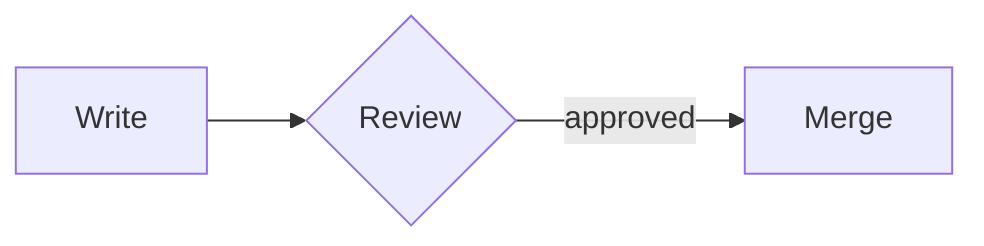

# Diagrams

A flowchart:



One that can't be drawn shows its source and why:

```mermaid
flowchart broken
    A -->
```

In a list:

- a step
  ```mermaid
  pie title Time
      "Code" : 60
      "Tests" : 40
  ```
