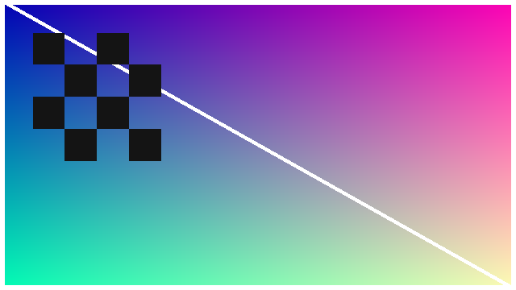
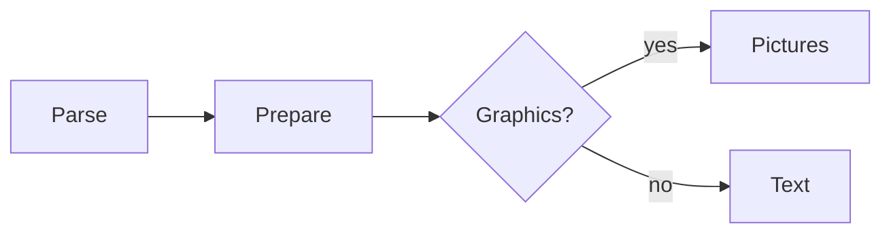
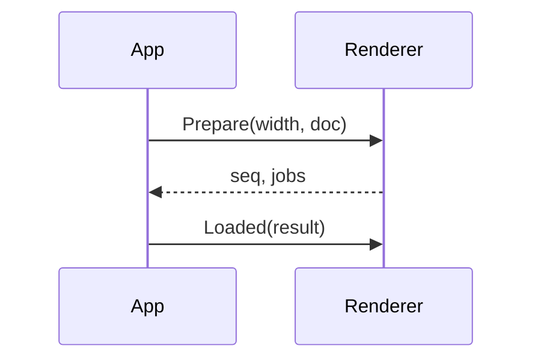

# markdown

A sample that shows everything the renderer draws. Run it with `go run ./cmd/mdview testdata/sample/sample.md`.

## Text

Paragraphs wrap to the width, with **bold**, *italic*, ~~struck~~, `inline code` and [links](https://github.com/ionut-maxim/markdown). Emoji and wide characters are measured the way the terminal does: 日本語, 👋🏽, ✅.

### Third level

#### Fourth level

##### Fifth level

###### Sixth level

## Lists

- A bullet
  - Nested
    - Deeper
- [x] A task that's done
- [ ] One that isn't

1. Ordered
2. From any number
10. Wider numbers line up

## Quotes and alerts

> A plain quote, with a bar.
>
> Over two paragraphs.

> [!NOTE]
> Useful information.

> [!TIP]
> A better way to do it.

> [!IMPORTANT]
> Something to know.

> [!WARNING]
> Needs attention.

> [!CAUTION]
> Could go wrong.

## Code

```go
func main() {
	fmt.Println("highlighted with Chroma")
}
```

## Tables

| Package | What it gives you | Status |
|:--|:--|--:|
| `markdown` | The renderer: parse once, render for a width | done |
| `kitty` | Kitty graphics with Unicode placeholders | done |
| `teamd` | Bubble Tea helpers | new |

## Images



## Diagrams





---

That's all.
